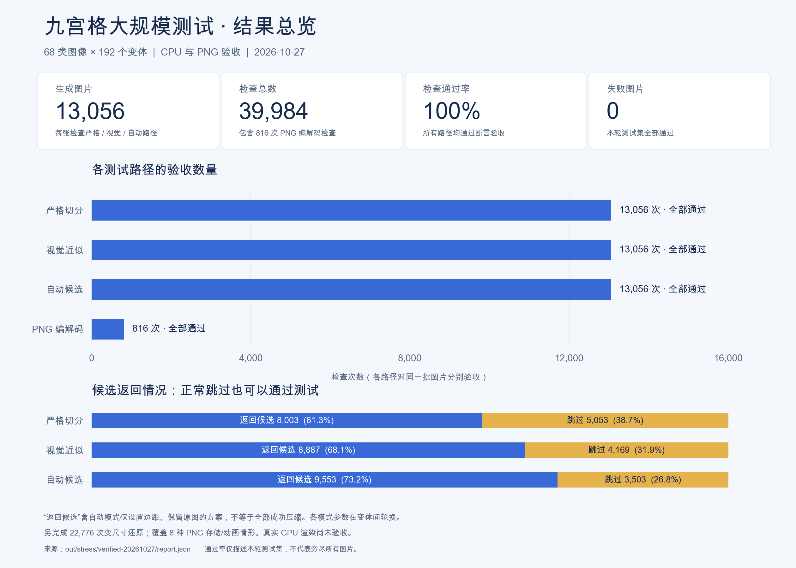

# 大规模九宫格生成测试

`scripts/stress_ninegrid.py` 从源码目录直接运行，只需要 NumPy 和 Pillow，不需要 pytest、Laya 工程、Node 或浏览器。生成图片的代码位于 `tests/stress/`，日常回归由 `tests/test_generated.py` 接入 pytest。

## 运行

```bash
# 日常生成回归：248 项，包括每个图像类别、PNG 存储格式和视觉控制参数。
.venv/bin/python -m pytest -q tests/test_generated.py

# 默认完整压力测试：68 类 × 192 变体 = 13,056 张图像。
.venv/bin/python scripts/stress_ninegrid.py --output out/stress/full

# 更密集地检查视觉与自动候选路径：每张图都检查三条路径。
.venv/bin/python scripts/stress_ninegrid.py --variants 256 --visual-every 1 --auto-every 1 --output out/stress/dense

# 小规模试跑，不使用多进程。
.venv/bin/python scripts/stress_ninegrid.py --variants 8 --visual-every 1 --auto-every 2 --workers 1

# 根据失败报告，精确复现图像和原测试参数。
# 保留原报告中的 seed、visual-every、auto-every、png-every。
.venv/bin/python scripts/stress_ninegrid.py --pattern exact/opaque/both --variant 64 --seed 20261027
```

输出目录必须为空或不存在，避免覆盖已有证据。返回码 0 表示全部检查通过，1 表示发现失败。不要使用 `python -O`，因为验收使用断言；脚本会拒绝这种启动方式。

默认每张图片运行严格模式；每 8 个变体运行视觉模式，每 64 个运行自动候选，每 16 个运行 PNG 编解码检查。对应 13,056 次严格检查、1,632 次视觉检查、204 次自动候选检查、816 次 PNG 检查，共 15,708 次路径检查，另有严格候选的多个目标尺寸重建。步长可配置为 1 全覆盖，或 0 关闭该附加路径。

视觉路径轮换 `center_size=1/8/2/16/32/64` 与 `axis=auto/horizontal/vertical` 的组合；严格路径轮换最小节省率 0、20%、50%、90%、100%，检查接受与跳过的阈值边界。

## 图像覆盖矩阵

| 组 | 覆盖内容 |
| --- | --- |
| 36 类精确可切图片 | 12 种风格分别生成双轴九宫格、横向三宫格、纵向三宫格：随机 RGBA、不透明、二值 Alpha、半透明、透明 RGB、纯色、空心、立体明暗边框、双边框、角部标记、边缘纹理、Alpha 阈值附近像素 |
| 纯色与透明度 | 完全透明、透明但 RGB 随机、纯色、半透明纯色、Alpha 噪声、Alpha 渐变、微小颜色和透明度扰动 |
| 边框与形状 | 抗锯齿圆角、胶囊及近圆形按钮、模糊阴影、凸起页签、四角装饰、带孔边框、内部透明间隙、外部透明留白；近圆形按钮可能无法达到 20% 压缩率，允许合理跳过 |
| 内容保护 | 中心徽记、文字标题、外缘单像素突变；中心徽记实心区域须保持，抗锯齿边缘受视觉误差预算约束 |
| 候选选择 | 多个不同长度重复带、等长带稳定择优、过短重复带、单方向渐变可沿另一方向压缩 |
| 应拒绝或限制压缩 | 随机噪声、二维渐变、径向渐变、棋盘格、周期中心纹理；由完整向量 oracle 和明确的视觉负样本预期判定，不强求所有纹理都返回同一个跳过原因 |
| 尺寸与边界 | 1×1、1×N、N×1、2×2、奇数尺寸、薄长条、对称/非对称/零/薄/厚边框，部分变体达到 1024 像素，长条可达 2048 像素 |
| 排列与内存 | 精确家族覆盖 90/180/270 度旋转、水平镜像及其组合；负步长、转置得到的非连续 NumPy 输入 |
| PNG 存储格式 | RGBA、RGB、L、LA、带调色板和逐项 Alpha 的 P、1-bit 黑白；16-bit PNG 和 APNG 必须明确拒绝 |

每个类别、变体和主种子通过稳定哈希确定独立随机种子；增加类别、调整进程数量或只运行某个类别不会改变已有图片。同一 `pattern/variant/seed` 可精确复现。

## 如何判定切分合理

1. **独立绘图**：精确家族用九个独立区域拼接生成图片；圆角、阴影和文字用 Pillow 绘制。生成器不调用生产代码中的重建函数。
2. **独立严格 oracle**：用简单循环比较每一整行、整列，得到最大重复带，验证最优输出面积、相同长度的稳定选择和节省率阈值。透明像素的隐藏 RGB 也参与比较。
3. **原尺寸及变尺寸**：独立重建必须与原图一致，再交叉检查生产重建。精确家族额外比较放大、缩小、仅改变一个方向、中心缩至 1 像素的四个目标尺寸，验证固定边框和角部。
4. **视觉误差**：以独立 float64 预乘 Alpha 计算均值、坏像素比例和最大误差，核对算法报告，并检查明确的正/负样本、固定角部及徽记实心区。搜索额外拒绝任意 8×8 区域中至少 75% 像素严重失真的候选，防止整张大图的误差额度集中抹掉一个小图案。视觉模式的采样保护像素属于可变中心，不误判为原始固定角部。
5. **自动候选**：解码并检查所有返回候选，验证去重、数量上限、尺寸、保留原图选项、平铺选项与 `cpuExact` 声明。线性中心候选用独立九块双线性重建，交叉检查专用还原模型及原始通道误差。报告统计候选编码和决策分支出现次数，便于发现未覆盖的路径。
6. **输入和编码**：检测与裁切不得修改输入；PNG 往返必须保存完整 RGBA，包括不可见 RGB。不支持的编码须明确报错。

## 报告

- `report.json`：总体结果、运行配置、耗时、分类统计、路径统计和全部失败详情。
- `cases.jsonl`：逐图结果，含实际种子、尺寸、阈值、中心大小、搜索轴、接受/跳过结果及异常堆栈。
- `index.html`：可在浏览器打开的样本目录。
- `images/*/index.html`：每类第一张图片，以及前 100 张失败图片的对比；包括原图、紫色切线、裁切图、独立还原图、放大 8 倍的红色差异图和 `case.json`。其余失败仍完整记录在 JSON 中。

这套矩阵覆盖常见九宫格结构、视觉模式和多种恶意边界输入，有限生成测试不能证明所有可能的图像都正确。上述验收限于 CPU 与 PNG；GPU 双线性采样、真实引擎缩放和图集接缝仍由 `tests/test_engine.py` 的真实引擎测试验证，不由这些结果代替。

## 2026-10-27 验收结果

本次以 `--variants 192 --visual-every 1 --auto-every 1` 运行：68 类、13,056 张生成图片，严格、视觉和自动候选三条路径均逐图检查；加上 PNG 检查共 39,984 次，全部通过。另完成 22,776 次变尺寸还原。完整回归为 406 项通过、8 项真实引擎测试跳过。

测试发现并修复了横纵保留中心尺寸不同时的候选解码错误，以及大图误差预算集中抹掉小徽记的问题。结论限于本轮 CPU 与 PNG 验收；没有据此宣称完成真实 GPU 验收或穷尽所有图像。



逐项统计和运行配置见 [验收报告](test-results/report.json)。图中的跳过表示未返回处理候选，不代表测试失败；自动模式的候选也可能保留原图，仅设置边距。
